<h1 align="center">COUTERULY</h1>

  <i>Интернет-магазин женской одежды с удобным каталогом и админ-панелью.</i>

 

## Скриншоты

  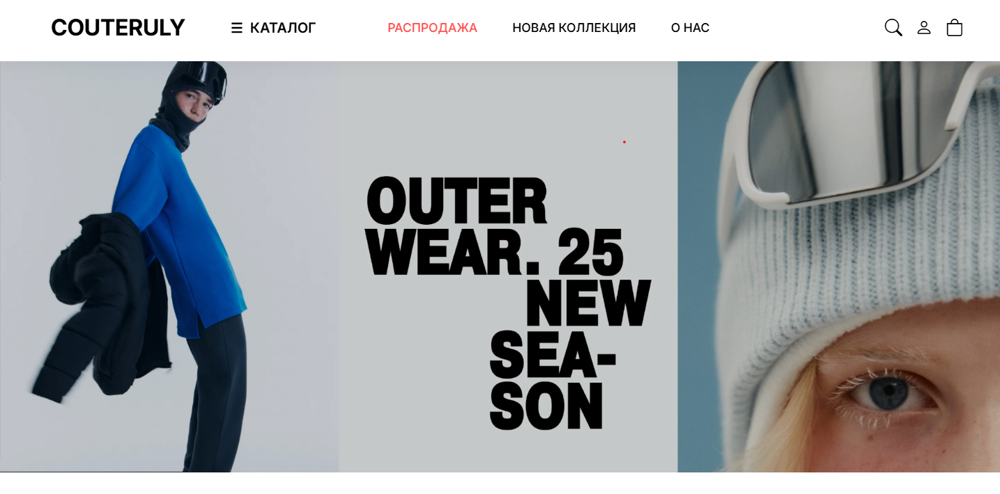
    
  
  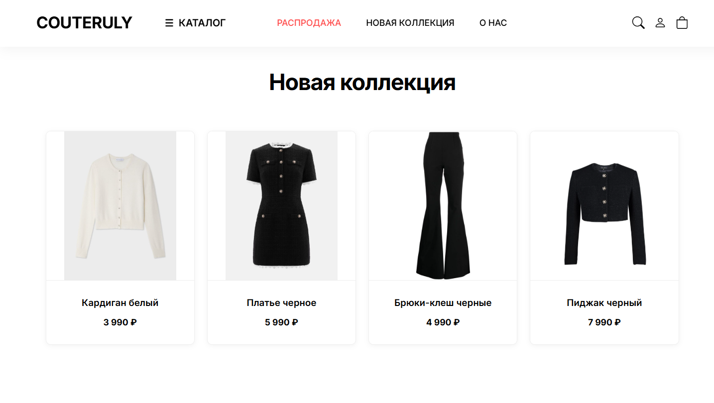
    
  
  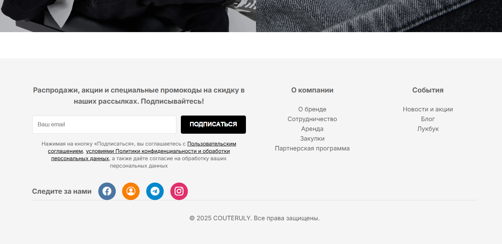
    
  
  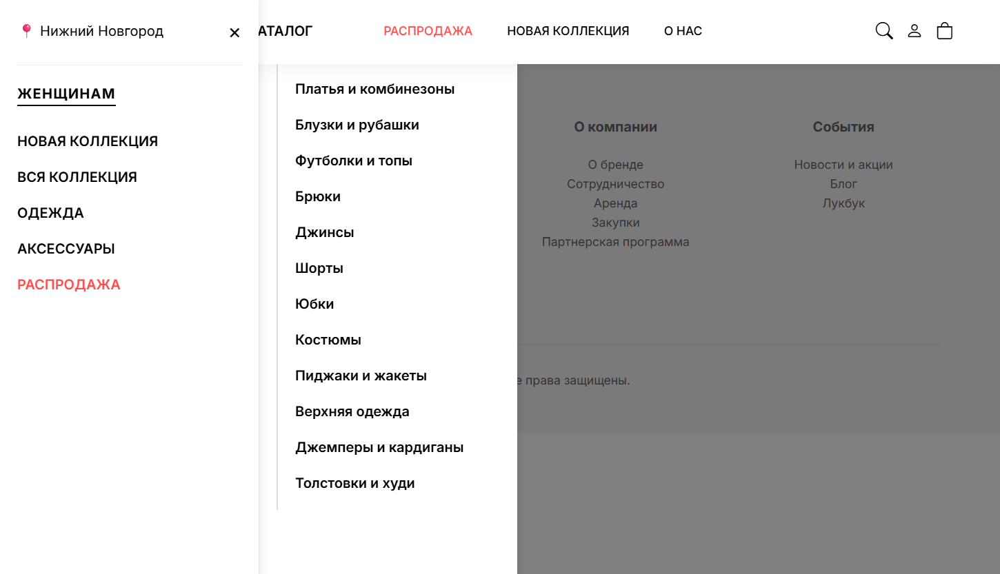
    
  
  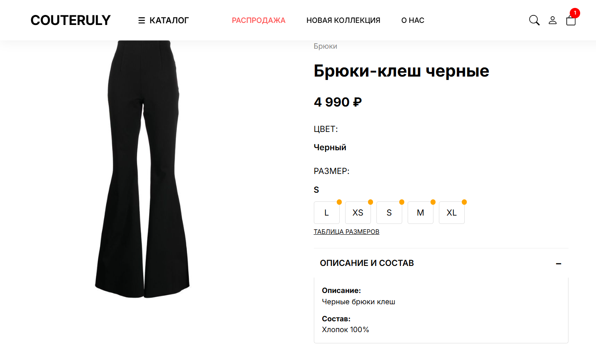
    
  
  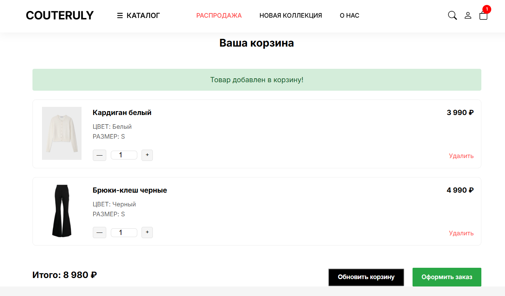
    
  
  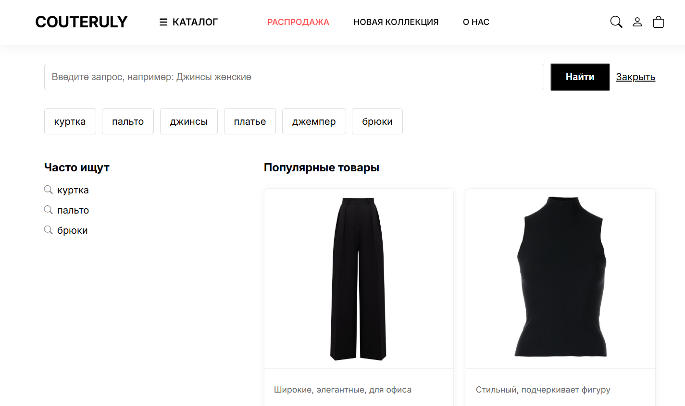
     

  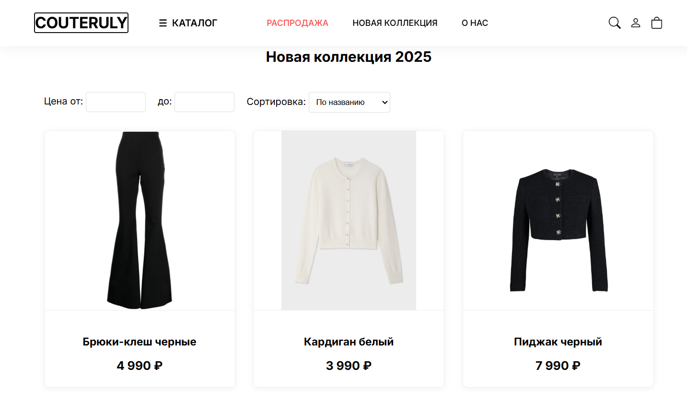
  &nbsp;&nbsp;
  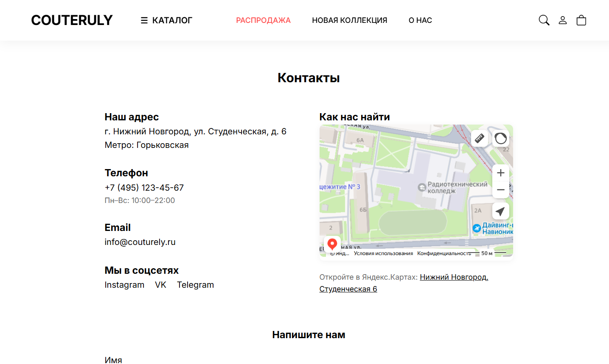
  &nbsp;&nbsp;
  
    

  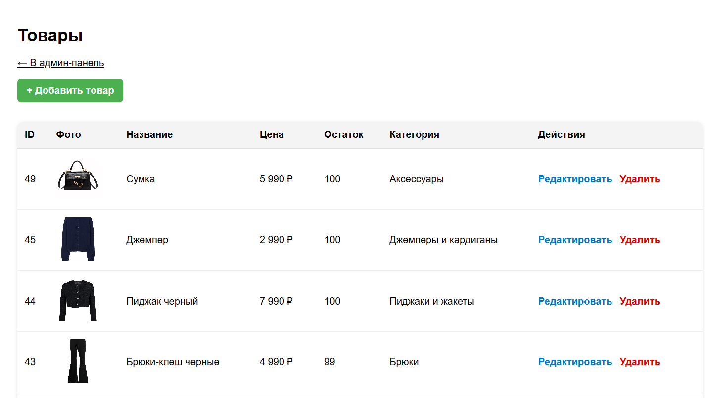
  &nbsp;&nbsp;&nbsp;&nbsp;
  
  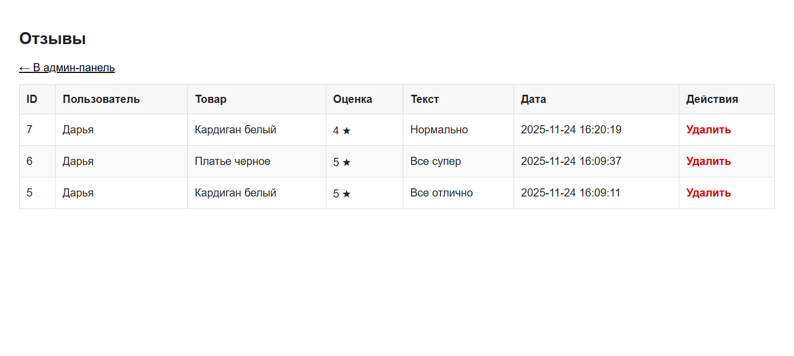
    

 

## О проекте

**COUTERULY** — это полноценный интернет-магазин одежды, разработанный с нуля. Проект включает в себя витрину товаров, систему поиска, корзину для покупок и защищенную административную панель для управления ассортиментом.

**Ключевой функционал:**
*    **Каталог:** удобный просмотр товаров с фильтрацией и категориями.
*    **Корзина:** добавление товаров, изменение количества и оформление заказа.
*    **Поиск:** быстрый поиск нужной модели по названию.
*    **Личный кабинет:** авторизация и регистрация пользователей.
*    **Админ-панель:** управление товарами, просмотр заказов, управление пользователями и отзывами.

##  Как развернуть локально
1. Создай новую базу данных в phpMyAdmin.
2. Импортируй в неё файл sql/recipefinder.sql (он лежит в корне проекта в папке sql).
3. В папке config/ открой файл db.php и укажи свои локальные настройки (логин и пароль от БД).
4. Открой проект

## Технологии

*   **Backend:** PHP 8.x, PDO
*   **Frontend:** HTML5, CSS3, JavaScript
*   **База данных:** MySQL
